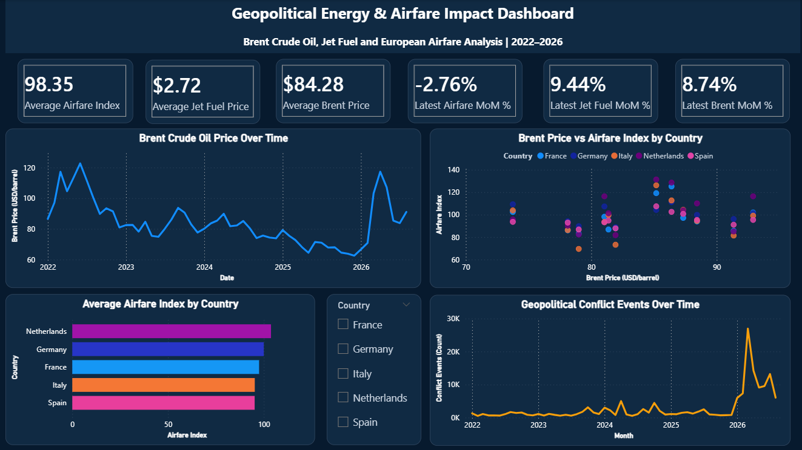

# Geopolitical Energy & Airfare Pipeline

### An End-to-End Data Engineering and Analytics Portfolio Project

**Technologies:** Python | pandas | PostgreSQL | SQL | Google BigQuery | GDELT | Power BI

## Project Overview

This project explores how geopolitical conflict activity, energy prices, and European airfare indicators evolved between January 2022 and August 2026.

It brings together multiple datasets covering Brent crude oil prices, jet fuel prices, airfare price indices, and geopolitical events involving the United States and Iran.

The project demonstrates practical skills in data extraction, transformation, validation, relational database design, SQL integration, and business intelligence reporting.

The objective is to provide a structured analytical view of these indicators rather than establish a causal relationship between geopolitical events and airfare prices.

## Business and Analytical Questions

The analysis focuses on four questions:

1. How have Brent crude oil and jet fuel prices evolved over time?
2. How do airfare price indices differ across selected European countries?
3. How has recorded US–Iran conflict activity changed during the analysis period?
4. What patterns can be observed when geopolitical, energy, and airfare indicators are examined together?

## Data Sources

| Dataset | Description |
|---|---|
| Brent crude oil | Historical crude oil price observations |
| Jet fuel | Historical aviation fuel price observations |
| European airfare HICP | Airfare-related consumer price indices for France, Germany, Italy, the Netherlands, and Spain |
| GDELT | Geopolitical event records involving the United States and Iran |

The analytical dataset covers **January 2022 to August 2026**, with monthly observations used to support comparisons across the different indicators.

## Technology Stack

| Technology | Role |
|---|---|
| Python | Data extraction, transformation, and validation |
| pandas | Data cleaning, aggregation, and integration |
| requests | API requests and file downloads |
| PostgreSQL | Relational storage of processed analytical datasets |
| SQL | Table creation, analytical views, and data integration |
| Google BigQuery | Historical GDELT data exploration and aggregation |
| Power BI | Interactive dashboards and analytical visualizations |
| Git and GitHub | Version control and project documentation |

## Data Pipeline Architecture

The project follows a multi-source analytical workflow:

```text
Brent Crude Oil Data ──┐
                       │
Jet Fuel Data ─────────┤
                       ├── Python Processing & Validation
European Airfare HICP ─┘                 │
                                        ▼
                                  Processed CSVs
                                        │
                                        ▼
                                   PostgreSQL
                                        │
GDELT Historical Events                 │
          │                             │
          ▼                             │
   BigQuery Analysis                    │
          │                             │
          ▼                             │
  Monthly Geopolitical Data             │
          │                             │
          └──────────► PostgreSQL ◄─────┘
                            │
                            ▼
                    SQL Integrated View
                            │
                            ▼
                    Power BI Dashboard
```

The repository also includes experimental scripts for accessing the GDELT API and downloading historical event files. These demonstrate alternative data acquisition and processing approaches, but should not be interpreted as a fully automated historical backfill pipeline.

## Data Processing and Integration

### Energy and Airfare Data

Python scripts support the extraction and preparation of Brent crude oil, jet fuel, and European airfare indicators.

The processing workflow prepares the datasets for monthly analysis and subsequent storage in PostgreSQL.

### Geopolitical Event Analysis

GDELT event data is used to examine conflict-related activity involving the United States and Iran.

The event-processing logic includes:

- Identifying events where the actor country codes are USA and IRN, in either order.
- Removing duplicate events using their global event identifiers.
- Filtering CAMEO event root codes from 13 to 20.
- Aggregating events at the monthly level.

Three geopolitical indicators are used:

| Metric | Definition |
|---|---|
| `conflict_events` | Number of distinct conflict-related events recorded during a month |
| `total_mentions` | Total recorded mentions associated with those events |
| `avg_goldstein` | Average Goldstein scale value for the selected events |

These indicators describe activity recorded by GDELT and should not be treated as direct measures of real-world conflict severity.

### PostgreSQL Integration

Processed datasets are stored in PostgreSQL, including:

- `public.energy_airfare`
- `public.gdelt_monthly`

The SQL view `public.vw_energy_airfare_geopolitical` combines the monthly energy, airfare, and geopolitical indicators for integrated analysis.

The integrated dataset contains **280 country-month observations**, representing five European countries across 56 months.

## Power BI Dashboard

The Power BI dashboard presents an interactive executive overview of the processed datasets.



### Key Performance Indicators

- Average airfare index
- Latest monthly airfare change
- Average jet fuel price
- Latest monthly jet fuel price change
- Average Brent crude oil price
- Latest monthly Brent crude oil price change

### Visualizations

- Brent crude oil price trends over time
- Brent crude oil prices versus European airfare indices
- Average airfare index by country
- Monthly geopolitical conflict events involving the United States and Iran

A country slicer enables comparisons between France, Germany, Italy, the Netherlands, and Spain.

The geopolitical event series is presented independently of the country filter because it represents US–Iran event activity rather than country-specific European airfare observations.

**Dashboard file:** `powerbi/geopolitical_energy_airfare_dashboard_v2.pbix`

## Repository Structure

```text
geopolitical-energy-airfare-pipeline/
│
├── data/
│   └── processed/
│       └── Processed analytical datasets
│
├── powerbi/
│   └── geopolitical_energy_airfare_dashboard_v2.pbix
│
├── sql/
│   ├── 01_create_tables.sql
│   ├── 02_create_gdelt_table.sql
│   └── 03_create_integrated_view.sql
│
├── src/
│   └── Python extraction, transformation,
│       and validation scripts
│
├── .env.example
├── .gitignore
├── requirements.txt
└── README.md
```

Raw datasets, local environment files, and credentials are excluded from version control.

## Local Setup

### 1. Clone the repository

```bash
git clone <repository-url>
cd geopolitical-energy-airfare-pipeline
```

### 2. Create a Python virtual environment

```bash
python -m venv .venv
```

Activate the environment on Windows:

```powershell
.venv\Scripts\Activate.ps1
```

### 3. Install dependencies

```bash
pip install -r requirements.txt
```

### 4. Configure environment variables

Copy `.env.example` to `.env` and provide the required API credentials.

Never commit real credentials or API keys to the repository.

### 5. Set up the database

Create a local PostgreSQL database named `geopolitical_energy_airfare`.

The `sql/` directory contains scripts for creating the analytical tables and integrated view.

The repository provides the individual processing components; it is not currently packaged as a single-command, fully automated deployment.

## Validation and Data Quality

The project includes Python validation scripts and SQL-based integration checks.

The analytical workflow considers:

- Duplicate event identifiers
- Missing dates and country codes
- Monthly date alignment
- Data completeness
- Consistency between integrated datasets

The integrated PostgreSQL view was checked for coverage across the five countries and 56-month analysis period.

## Analytical Limitations

Several limitations should be considered when interpreting the dashboard:

- Observed relationships between geopolitical activity, energy prices, and airfare indices do not establish causation.
- Airfare HICP values are price indices, not actual airline ticket prices.
- GDELT event counts depend on event coverage, classification, and reporting patterns.
- The geopolitical series focuses specifically on recorded US–Iran conflict-related activity.
- Monthly aggregation can obscure shorter-term fluctuations and delayed effects.
- Some GDELT scripts are exploratory and do not independently reproduce the complete historical dataset.

## Skills Demonstrated

This project demonstrates practical experience in:

- Multi-source data acquisition
- Python-based ETL workflows
- Data cleaning and validation
- SQL database design
- Relational data integration
- Time-series analysis
- Geopolitical event data processing
- Interactive Power BI dashboard development
- Technical documentation and version control

## Future Improvements

Potential enhancements include scheduled data refreshes, automated historical ingestion, expanded geopolitical coverage, stronger reproducibility controls, and statistical analysis of time-lagged relationships.

---

**Project type:** Data Engineering & Analytics Portfolio Project

**Analysis period:** January 2022 – August 2026